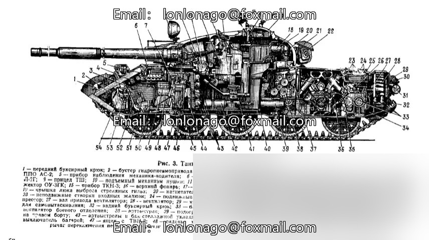
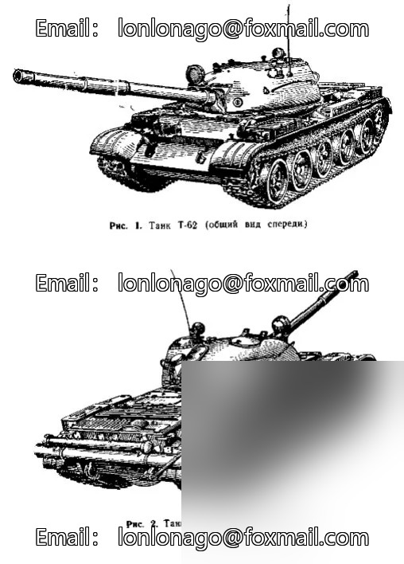
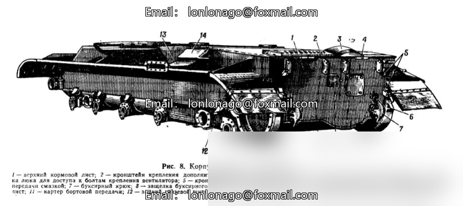
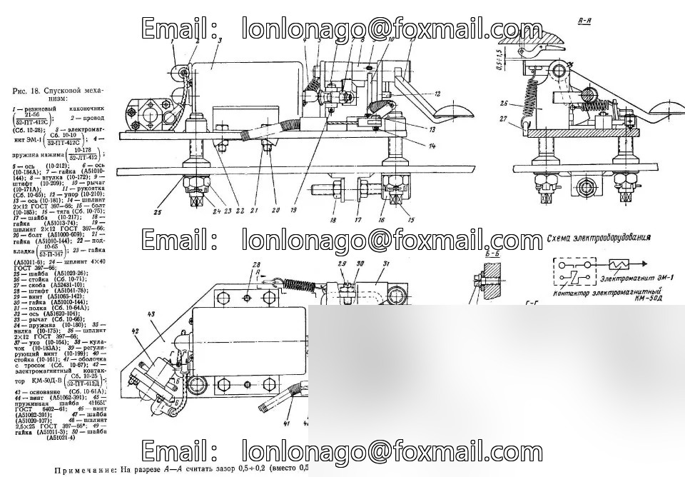
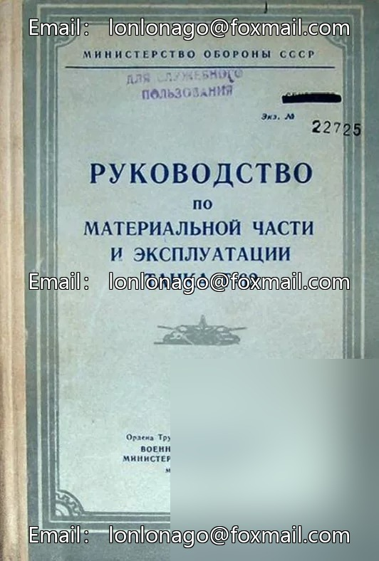
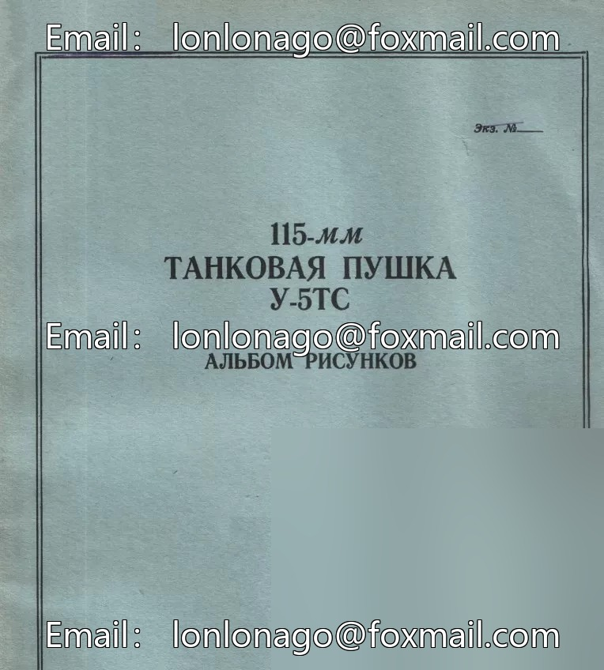

# Soviet T-62 main battle tank technical materials, original 1968 manual, including the tank

## Body

Soviet T-62 main battlefield tank technical materials, 1968 original specification, including the full tank structure, U-5TS drawing of the 115-millimeter tank gun.

The material provides technical information on the Soviet T-62 main battle tank, including the 1968 original manual and full-car structure details.

<!-- AI_ENRICHED -->

## Images

## Payment

Here is a pay link on Stripe ( https://buy.stripe.com/3cs8yP7sY87d0vu9AB ). Please contact me lonlonago@foxmail.com after funding $89, and I will send you a complete data files , thank you!

